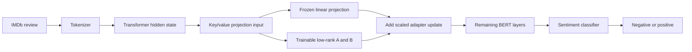
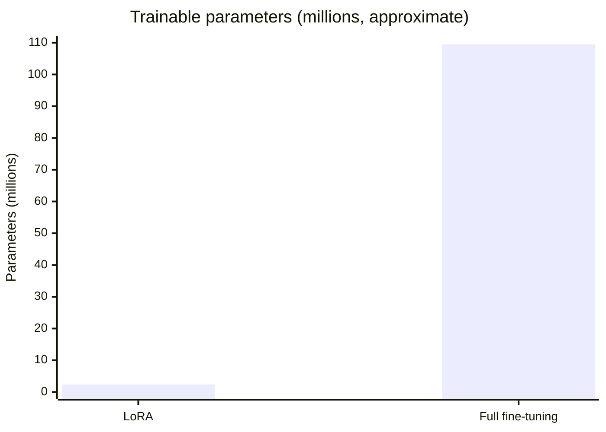

# LoRA from Scratch

git 
A small PyTorch implementation of Low-Rank Adaptation (LoRA), with an IMDb sentiment-classification experiment using BERT. The adapter code is in `Lora.py` and `LoraModel.py`; the experiment and result review are in `LoraTest.ipynb`.

Thank you for reviewing this repository for its goal is to provide the LoRA algorithm from scratch. The code was built to align with the LoRA description from research and online resource. This Algorithm was tested on the Bert-Base-Uncased model. The testing case can be found in the LoraModel.ipynb. Just a heads up, it will take a little while to run the model. 

## What the code does

The implementation wraps selected `nn.Linear` layers. It freezes the pretrained weights and learns two smaller matrices, A and B, whose update is added to the original layer output:

`output = original_layer(x) + (alpha / r) * B(A(dropout(x)))`

In the notebook, the adapters are applied to the attention `key` and `value` projections in `bert-base-uncased`. This is a compact example for learning and comparison; it is not intended as a replacement for a production adapter library.



## Experiment

The notebook loads the Stanford IMDb dataset, reserves 10% of its training split for validation, and keeps the official test split for final predictions. Reviews are tokenized with a 512-token limit. Both runs use two epochs, a batch size of 16, and a learning rate of `2e-5`; the LoRA run uses rank 64, alpha 128, and dropout 0.1. Full fine-tuning is the baseline.

The parameter chart below is calculated from the BERT-base dimensions and this notebook's key/value adapter settings. It is not a training result. The LoRA count includes only its trainable A and B matrices; full fine-tuning counts all model parameters.

The notebook currently contains cached output from an earlier run. Those values do not match the key/value-only configuration described here, so rerun the notebook from the first cell before using any displayed scores or counts.



After running the notebook, its final analytics cell prints accuracy, precision, recall, and F1 for both runs, along with per-class reports. It also displays and saves comparison charts under `results/`: `metrics_comparison.png`, `confusion_matrices.png`, `loss_curves.png`, and `trainable_parameters.png`.

## Run it

Use Python 3.10 or newer. Install the project dependencies, then open and run `LoraTest.ipynb` from top to bottom:

```bash
pip install -r requirements.txt
```

The first run downloads the IMDb dataset and the pretrained BERT tokenizer/model. Training can take a while, especially on CPU. The notebook runs LoRA and full fine-tuning sequentially, so it needs more time and memory than a LoRA-only run. A CUDA-enabled PyTorch install is useful when a compatible GPU is available; follow the [official PyTorch install selector](https://pytorch.org/get-started/locally/) for the right build.

For background on the implementation, see [Low-Rank Adaptation (LoRA) from Scratch with Python](https://medium.com/@a2zdeveloper/low-rank-adapation-lora-from-scratch-with-python-part-1-ee04c8093370).